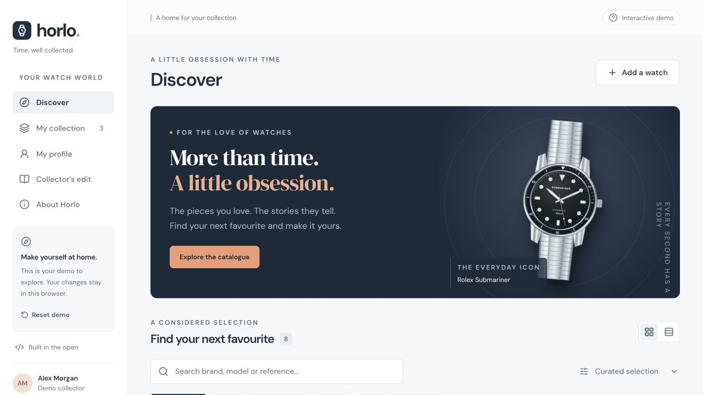

<p align="center"></p>

<h1 align="center">Horlo</h1>
<p align="center">A little obsession with time.</p>
<p align="center">Explore iconic watches. Curate your collection. Make it yours.</p>
<p align="center"><a href="https://somilagg123.github.io/horlo/">Try the live demo</a> · <a href="https://somilagg123.github.io/horlo/#/shared/collectors-edit">Explore the collector’s edit</a></p>


Horlo is an interactive watch collection app and personal portfolio project. It runs entirely in the browser, with no sign-up, backend, API keys, or database setup.



[Full catalogue screenshot](docs/screenshots/discover.png) · [Example collection screenshot](docs/screenshots/collectors-edit.png)

## Explore

- **Discover watches:** eight curated references with manufacturer-sourced specifications and original SVG illustrations. Search by brand, model, or reference; filter by style; sort and switch between grid and list views.
- **Make a collection:** add and remove watches, open detailed specifications, and explore the dials up close. Your collection survives a reload.
- **Add your own:** create a custom watch with a story and an optional JPEG, PNG, or WebP photo. Images are resized locally; they never leave your browser.
- **Make it personal:** edit the sample collector’s name, location, and bio.
- **See a public collection:** the collector’s edit demonstrates a shareable collection page. Its link always opens the same curated sample, without exposing your local data.
- **Start fresh:** reset only Horlo’s demo data with a confirmation. Other browser storage is left alone.

## Run locally

Use **Node.js 24** (the project requires at least 22.12) and npm.

```sh
git clone https://github.com/SomilAgg123/horlo.git
cd horlo
nvm use # optional, if you use nvm
npm ci
npm run dev
```

Open the printed URL, normally `http://127.0.0.1:5173/horlo/`. No `.env` file is needed.

| Command                | Purpose                                      |
| ---------------------- | -------------------------------------------- |
| `npm run dev`          | Local development with hot reload            |
| `npm run check`        | TypeScript, unit tests, and production build |
| `npm run format:check` | Check consistent source formatting           |
| `npm run format`       | Format source files                          |
| `npm run build`        | Build the static site into `dist/`           |
| `npm run preview`      | Preview the production build locally         |
| `npm run test:e2e`     | Run the desktop and mobile browser journeys  |

For browser tests, first run `npm run build` and `npx playwright install chromium`. On Linux, use `npx playwright install --with-deps chromium`. Tests start a production preview automatically and cover filtering, persistence, photo upload, validation, profile editing, reset, and deep links at desktop and mobile sizes.

## How it works

**React · TypeScript · Vite · React Router · Zod · Vitest · Playwright**

```text
src/
  components/   Reusable watch cards
  data/         Curated catalogue, schema, filtering
  lib/          Local photo preparation
  pages/        Discover, collection, details, profile, custom watch, example share
  state/        Versioned browser storage and demo state
public/watches/ Original watch illustrations
tests/          Browser journeys and synthetic image fixture
docs/           Architecture, catalogue sources, and screenshots
```

React Context owns the small amount of shared state. Zod validates persisted records before use. `localStorage` stores the collection, custom watches, and demo profile under `horlo.demo.v1`. Invalid saved data recovers to the sample collection with a visible notice. Blocked or full storage is reported, and the current visit remains usable.

The app uses hash routes (`#/watch/rolex-submariner`) so opening or refreshing a deep link works on GitHub Pages. Vite’s base is `/horlo/`, including all fonts and illustrations. There are no runtime API requests or third-party image dependencies. [Read the architecture notes](docs/ARCHITECTURE.md).

## Deployment and PR workflow

Changes are built through pull requests. The Checks workflow runs type checks, unit tests, formatting, production compilation, and browser tests. Merging to `main` runs those checks again, then builds and deploys to GitHub Pages. Failed checks prevent deployment. No deployment secret is required: the workflow uses GitHub’s built-in permissions.

In repository **Settings → Pages**, the source must be **GitHub Actions**. When forking to another repository name, update `base` in `vite.config.ts`, the `/horlo/` test URLs, and the README/site links. See [deployment and maintenance](docs/ARCHITECTURE.md#deployment-and-maintenance) for rollback instructions.

## Demo boundaries

This is a finished interactive demo, not a live marketplace or multi-user service. The sample profile is fictional. Your edits stay in this browser and do not sync between devices or tabs; clearing browser storage removes them. Custom watch links only resolve in the browser where they were created. The shared collection is a fixed example, not a publication of your personal collection.

The demo accepts up to 30 custom watches. Selected images may be up to 5 MB and are resized to at most 800 pixels before saving; browser storage quotas still apply. There are no purchases, prices, accounts, analytics scripts, or collection uploads. GitHub Pages serves the site and may retain standard hosting logs.

## Project history and credits

This edition grew out of the earlier [watch-project-frontend](https://github.com/SomilAgg123/watch-project-frontend), [collectors-favourite](https://github.com/Kevin-0j/collectors-favourite), and [watch-fastAPI](https://github.com/Kevin-0j/watch-fastAPI) experiments. Those repositories informed the product: catalogue discovery, personal collections, watch details, and sharing. This rebuild preserves that idea in a self-contained demo, with fresh implementation and assets, and acknowledges the earlier collaboration between SomilAgg123 and Kevin-0j.

Watch specifications are credited to their manufacturers in [catalogue sources](docs/CATALOGUE-SOURCES.md). The illustrations are original, stylized drawings, not product photos. Brand names remain the property of their respective owners; Horlo is independent and unaffiliated. Icons come from Lucide (ISC); DM Sans and DM Serif Display are distributed through Fontsource under the SIL Open Font License.

Project code and original illustrations are available under the [MIT license](LICENSE). Third-party packages and fonts retain their respective licenses.
