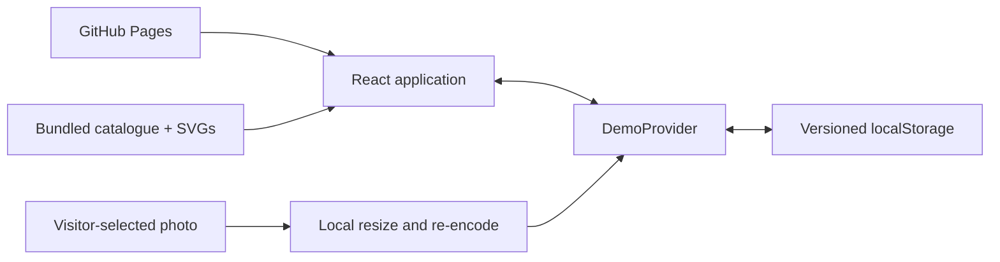

# Architecture

Horlo is a static, browser-only demo. Its purpose is to make the watch collection concept easy to explore from a public GitHub repository and GitHub Pages site.

## Data and state

`src/data/watches.json` is the curated catalogue. The Zod watch schema defines valid records, including optional labels for non-round cases and qualitative water-resistance ratings. Search is local and combines category filters with case-insensitive brand, model, reference, and movement matching.

`DemoProvider` owns the visitor's collection IDs, custom watches, and profile. Watch specifications belong to catalogue entries; selection belongs to the visitor's collection. A custom watch is saved in this browser's catalogue and can be removed from or re-added to the collection.

`src/state/storage.ts` loads and validates the `horlo.demo.v1` record. Unknown IDs and duplicate collection selections are removed. Malformed data or a mismatched schema version starts a fresh demo with a notice. Storage errors do not break the current session. Reset replaces only Horlo's own record. This implementation intentionally has no cross-tab synchronization or server persistence; concurrent tabs may overwrite their respective local changes.

## Images and external data

All sample illustrations and fonts are shipped with the build. The app does not fetch data or images at runtime. Manufacturer links are ordinary external links opened only when clicked.

Visitor-selected photos are restricted to JPEG, PNG, and WebP, up to 5 MB. `preparePhoto` decodes the image, scales its longest dimension to at most 800 pixels, and re-encodes it as JPEG. The result is stored locally. Image decoding failures, unsupported files, and storage limitations produce visible feedback. SVG upload is intentionally unsupported; bundled SVGs are trusted project assets.

Descriptions and names are rendered as text, never injected as HTML. Persisted image values are restricted to bundled watch assets or raster data URLs. Persisted source links must use HTTPS. The application contains no credentials or environment variables.

## Routing and accessibility

`HashRouter` keeps the complete route after `#`, allowing GitHub Pages to serve `index.html` on deep-link refresh. `imagePath` prefixes bundled assets with Vite's configured `/horlo/` base.

The UI uses semantic navigation and forms, visible labels, pressed states on collection and filter buttons, live status messages, a skip link, route focus management, reduced-motion styles, and a native confirmation dialog. The mobile navigation hides off-screen controls from focus, makes the background inert while open, and closes on navigation or Escape. Forms and cards adapt to mobile widths.

## Testing

- Unit tests exercise persistence round trips, malformed state, storage failures, unsafe saved values, and filtering/sorting behavior.
- Playwright tests exercise complete browser journeys at desktop and mobile sizes against the production build, including a synthetic local photo fixture and preservation of unrelated storage during reset.
- Manual browser checks cover visual layout, photo selection, mobile navigation, and the live deployed site.

## Deployment and maintenance

The public repository is `SomilAgg123/horlo`. The static output is `dist/`; GitHub Pages uses Actions as its publishing source. `checks.yml` runs on pull requests and is reusable by `pages.yml`. On a merge to `main`, the Pages workflow runs checks, builds the site, uploads the artifact, and deploys only after all prior jobs succeed. Deployments use the `github-pages` environment and built-in `pages: write` and `id-token: write` permissions.

For routine changes:

1. Create a branch and keep the change focused.
2. Run `npm run check` and `npm run format:check`; check the affected screen locally.
3. Open a PR and let the desktop/mobile browser checks finish.
4. Merge only passing changes. The Pages workflow publishes automatically.

To roll back a regression, revert the introducing PR through a new PR and merge the revert after checks pass. The resulting deployment restores the earlier behavior. Re-running an old workflow is not a substitute for aligning `main` with the intended source.

The local directories containing earlier versions remain separate. Their database and upload credentials were not migrated into this repo. Any still-active credentials exposed by those historical repositories must be revoked by their service owners; publishing this clean edition does not invalidate old credentials.
